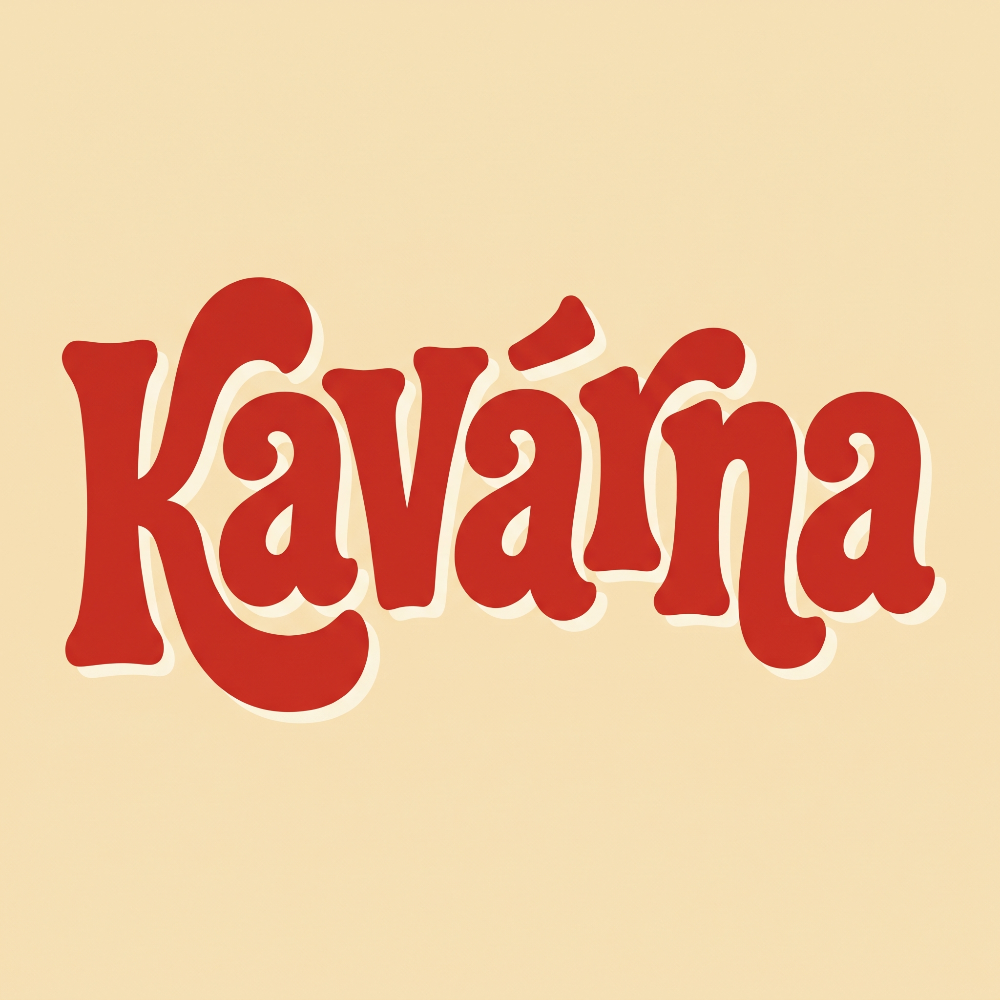

# Odoo de principio a fin: usuarios, grupos, privilegios y venta completa

**Alumna:** Laura Rubio
**Módulos:** Sistemas de Gestión Empresarial - 2º DAM
**Empresa:** (Pendiente de definir en el Apartado 3)
**Palabra del día:** No hay palabra del día

# Implantación de Odoo 19 Community — Kavárna Concept ☕✨

Repositorio de la práctica de **Sistemas de Gestión Empresarial (UD7 - Odoo)** donde se documenta el despliegue en Docker, la configuración de la empresa ficticia **Kavárna Concept**, la gestión de usuarios con principio de mínimo privilegio y un ciclo completo de venta.



---

## 📋 Datos del Proyecto

* **Alumna:** Laura Rubio
* **Empresa ficticia:** Kavárna Concept S.L. (Lifestyle y café de especialidad)
* **ERP desplegado:** Odoo 19 Community Edition (mediante Docker Compose)
* **Acceso local:** `http://localhost:8200`

---

## 📂 Índice de Documentación y Entregables

### 1. Instalación y Arquitectura
* 📄 [Guía de instalación y arquitectura en Docker](instalacion/instalacion-odoo.md)
* 🛠️ [Registro de errores de instalación y solución](instalacion/errores-instalacion.md)

### 2. Configuración de la Empresa
* 🏢 [Ficha de empresa, catálogo de productos y clientes](empresa/ficha-empresa.md)
* 🖼️ [Logo corporativo](empresa/logo.jpg)

### 3. Usuarios, Grupos y Permisos
* 🔐 [Plantilla de usuarios, roles, grupo personalizado y pruebas de acceso](usuarios/usuarios-grupos-permisos.md)

### 4. Ciclo Completo de Ventas
* 🛒 [Documentación del proceso de ventas y trazabilidad](venta/proceso-venta.md)
* 📑 [Presupuesto generado (PDF)](venta/Presupuesto%20-%20S00025.pdf)
* 🧾 [Factura emitida y pagada (PDF)](venta/INV_2026_00001(factura).pdf)

### 5. Vídeo Demostrativo y Capturas
* 🎥 [Ver el video en YouTube](https://youtu.be/bw0S0CEg_Zo)
* Video en dos formatos, para descarga y en un .md para enlace de YouTube
* 📸 Todas las evidencias visuales (productos, contactos, usuarios y roles) se encuentran organizadas en la carpeta [`capturas/`](capturas/).

---

## 🗂️ Estructura del Repositorio

```text
sge-ud7-odoo/
├── capturas/        # Capturas de productos, clientes, usuarios y roles
├── empresa/         # Ficha de empresa y logo de Kavárna Concept
├── instalacion/     # Guía de despliegue en Docker y registro de incidencias
├── usuarios/        # Configuración de roles, permisos y grupo propio
├── venta/           # Documentación del ciclo de venta, presupuesto y factura en PDF
├── video/           # Vídeo demostrativo del funcionamiento en Odoo
└── README.md        # Índice principal del proyecto
```