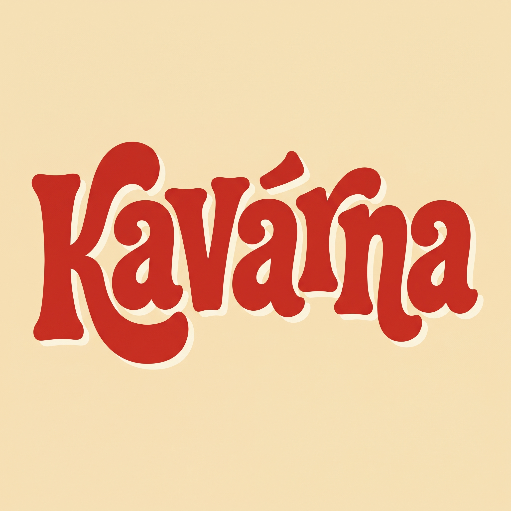
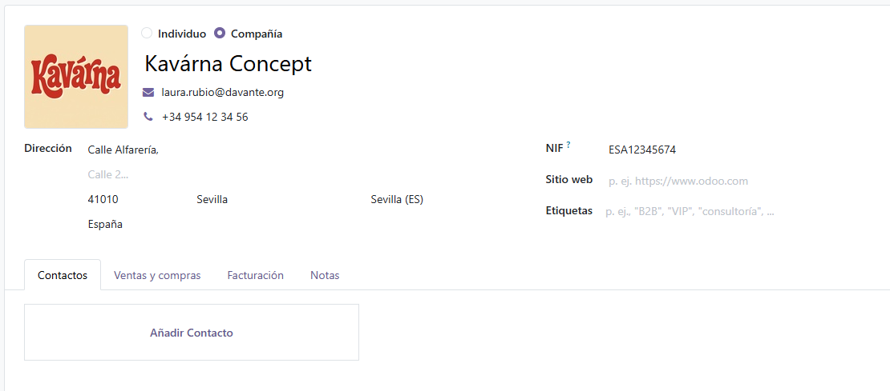
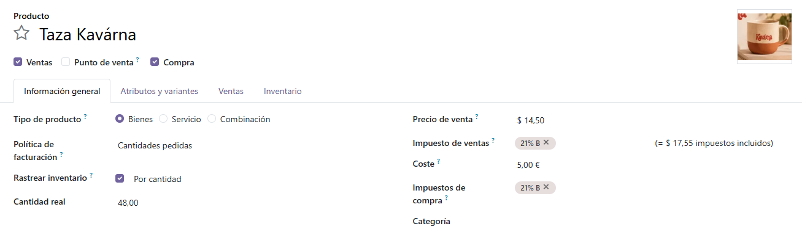
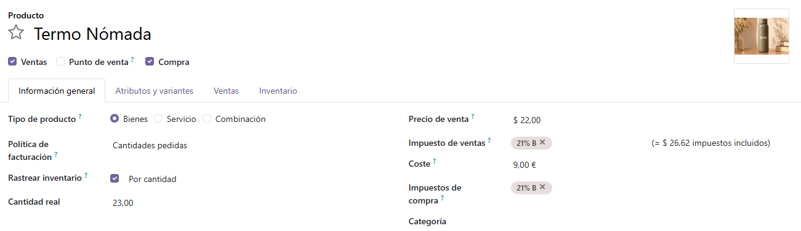
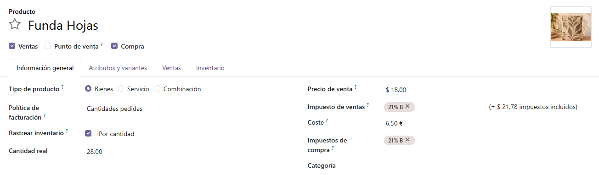
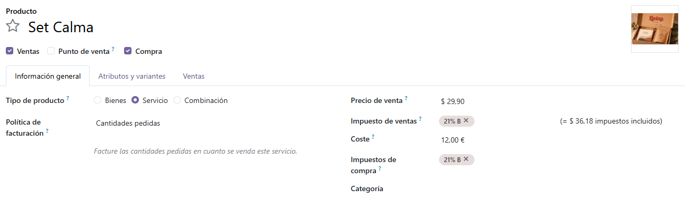
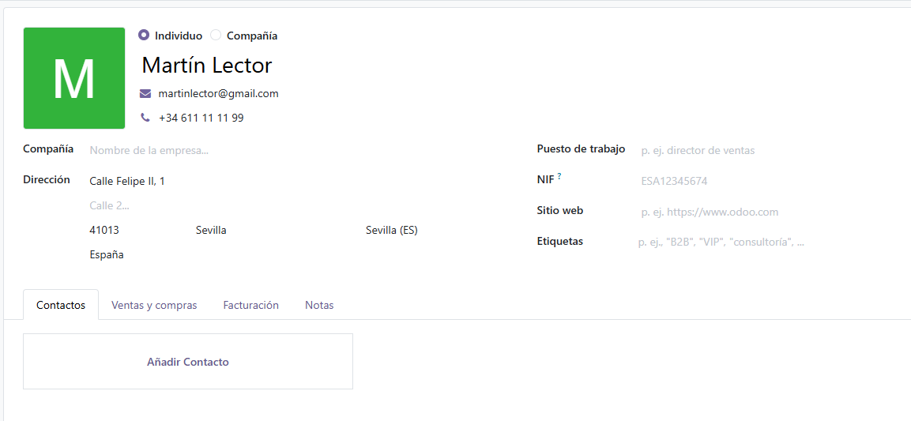
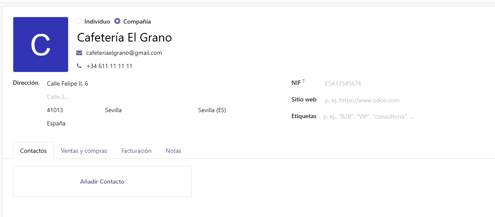

# Ficha de Empresa: Kavárna Concept

##1. Datos de la Compañia en Odoo

Para que las facturas y los presupuestos salgan con los datos correctos, me fui a **Ajustes > Usuarios y comapañías > Compañías** y rellené la ficha de la empresa con la siguiente información:
* **Nombre Comercial:** Kavárna Concept
* **Razón Social:** Kavárna Concept S.L.
* **Sector:** Retail / Lifestyle y Café de Especialidad.
* **CIF (Ficticio):** B41999999
* **Dirección:** Avenida de la Innovación, 15, Edificio 2.
* **Código Postal y Ciudad:** 41020, Sevilla (Sevilla Este).
* **Provincia y País:** Sevilla, España.
* **Teléfono:** +34 600 111 222
* **Correo Electrónico:** hola@kavarnaconcept.es
* **Sitio Web:** https://www.kavarnaconcept.es
* **Moneda:** EURO

Para las facturas y presupuestos, le añadí colores de mi paleta, beige, un rosa sueve y un verde salvia. Y subí el logo de la marca para que los documentos PDF tuvieran un toque más profesional.

## 2. Nuestro Catálogo de Productos

Para hacer las pruebas de ventas y del almacen, he creado varios productos básicos para trabajar con ellos, y usarlos en el video. Y a cada uno le he aplicado el 21% de IVA aplicado

| Referencia | Nombre del Producto | Precio de Venta | Tipo de Producto | Captura |
| :--- | :--- | :--- | :--- | :--- |
| **KAV-TAZ-01** | Taza Kavárna | 14,50 € | Bienes |  |
| **KAV-TER-01** | Termo Nómada | 22,00 € | Bienes |  |
| **KAV-FUN-01** | Funda Hojas | 18,00 € | Bienes |  |
| **KAV-CAL-01** | Set Calma | 29,90 € | Servicio |  |

Dependiendo del producto puede ser bienes o servicio, en mi caso he creado tres productos que son bienes y un producto que es unn servicio. Además es importante marcar la casilla de "Por cantidad", para así registrarlo en el almacen e inventario tenga cantidad del stock que hay

## 3. Clientes Registrados
Para poder probar el ciclo de venta, desde que se pide un pedido hasta que se cobra, he creado dos contactor en la base de datos de Odoo: un cliente particular y una empresa

### Cliente Particular (El que hemos usado para la demo)
* **Nombre:** Martín Lector
* **Tipo:** Particular (B2C)
* **Correo:** martin.lector@gmail.com
* **Dirección:** Sevilla, España.
* *Uso:* Es el cliente principal al que le hemos hecho el presupuesto `S00025`, le hemos entregado los productos y finalmente le hemos facturado.

### Cliente de Empresa (Para pedidos grandes)
* **Nombre:** Cafetería El Grano
* **Tipo:** Empresa (B2B)
* **NIF:** ESA12345674
* **Correo:** cafeteriaelgrano@gmail.com
* *Uso:* Creado para futuras pruebas de presupuestos con grandes volúmenes de stock y condiciones de pago a 30 días.

