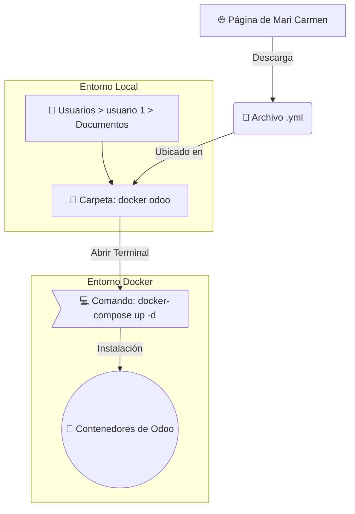

# 1: Entorno y Arquitectura

## **Versión y Edición**
* **Sistema:** Odoo (Community Edition)
* **Tipo de instalación:** Docker (mediante archivo `docker-compose.yml`)
* **¿Por qué has elegido esta instalación?:**  Docker nos permite hacer un despliegue rápido, nos aisla del
sistema operativo principal, nos ebita conflictos de dependencias y levanta Odoo y sus bases de datos juntos
con un solo comando

## **Requisitos del Sistema**
* **Hardware mínimo:** 2 Cores CPU  | Mínimo 4 GB RAM  | 10 GB Almacenamiento 
* **Software:** Windows 10/11 (64 bits)
* **Entorno:** Docker Desktop instalado y ejecutandose

## **Esquema visual (Arquitectura)**


* **Origen del archivo:** Descarga el archivo .yml desde la páguina web HelloMariCarmen
* **Directorio de trabajo:** Creación de la carpeta docker odoo en la ruta local Usuario > usuario 1 > Documentos
* **Despliegue:** Ubicación del archivo .yml dentro de la carptera y ejecución del comando docker-compose up -d desde la terminal para realizar la instalación

## **Proceso de Instalación**
1. **Instalar Docker:** Descargamos Docker Desktop for Windows, instalamos con la opción de WSL 2 marcada e iniciamos sesión
2. **Descargamos el archivo:** Descargamos el archivo 'docker-compose.yml' directamente desde la página de HelloMariCarmen
2. **Preparar el Directorio:** En nuestro equipo local, navegamos a la ruta 'Usuario > usuario 1 > Documentos' y crear una nueva carpeta llamanda 'docker odoo'
3. **Ubicación:** Mover el archivo '.yml' que hemos descargado dentro de la carpeta 'docker odoo'
4. **Despliegue:** Abrimos la terminal directamente desde esta ruta y ejecutamos el comando:
```bash
docker-compose up -d
```
5. **Finalización:** Esperamos que termine el proceso de insalación y los contenedores se levanten correctamente.

## **Acceso al Sistema**
* **URL de Entrada:** http://localhost:8200
* **Mapeo de Puertos:** Host (8200) -> Contenedor Odoo (8069)
* **Credenciales por defecto:**
* * **Usuario:** admin
* * **Contraseña:** admin
