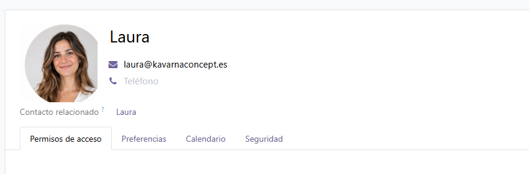
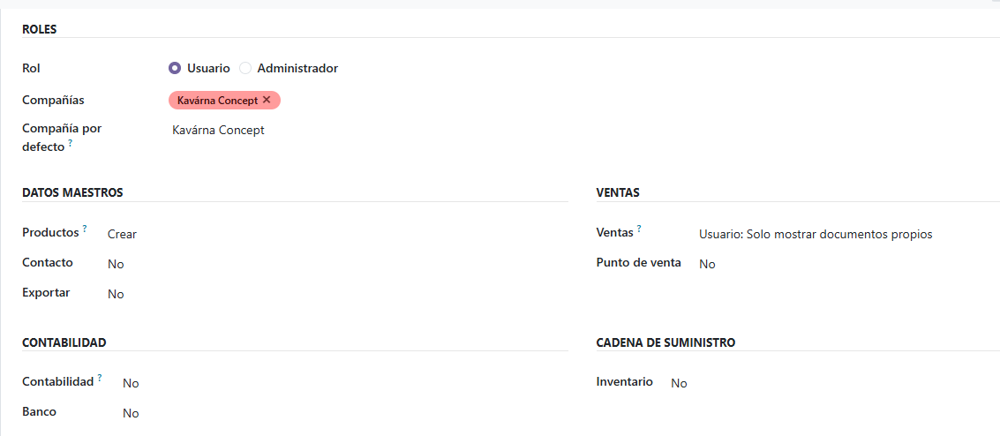
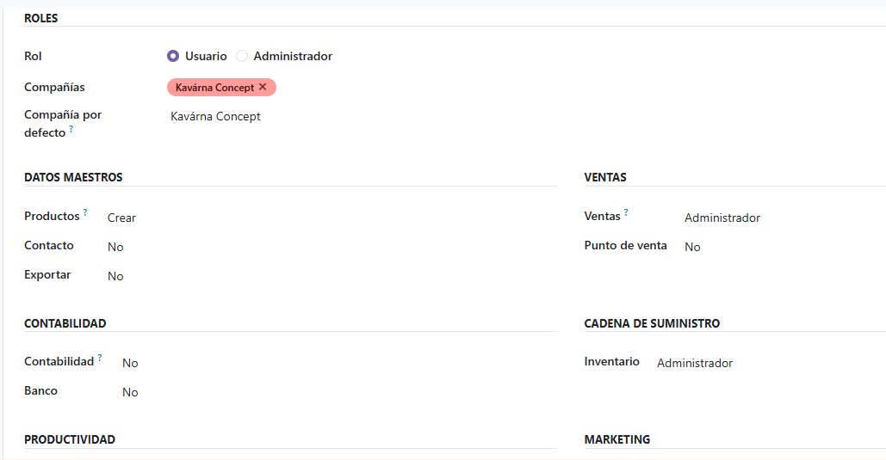
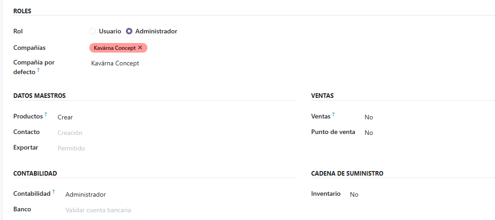

# USUARIOS, GRUPOS Y PERMISIS - KAVÁRNA CONCEPT

Para organizar el equipo de Kavárna Concept en Odoo he querido aplicar el principio de mínimo privilegio. Esti quiere decir que cada trabajador cuando inicia sesión solo pueda ver en su menú las opciones necesarias para realizar su trabajo. Así evitamos el riesgo de que trabajadores sin experiencias en otros sectores dañen material al no saber usarlo

## 1. Tipos de usuario en Odoo

Antes de crear las cuentas, debemos diferenciar los tres tipos de acceso diferentes que maneja Odoo según quién inicie sesión:

* **Usuario Interno:** Somos los empleados de la empresa (Laura, Ander y Marta). Entramos en el interior de Odoo para trabajar con las opciones de menú que tengamos asignados.
* **Usuario Portal:** Pensado para clientes o proveedores externos (por ejemplo, nuestro cliente particular **Martín Lector**). No ven el panel de gestión ni los datos de la empresa; solo tienen acceso a una zona web privada para consultar sus propios presupuestos, pedidos o facturas.
* **Usuario Público:** Cualquier persona que entra a la web sin iniciar sesión. Solo puede ver lo que sea público, catálogo o información general. Y no tiene permisos para modificar nada.

## 2. Plantilla de Kavárna Concept y asignación de permisos

Todas las cuentas internas se han creado desde **Ajustes > Usuarios y compañías > Usuarios** con su nombre, correo corporativo ficticio y avatar, asignándoles la compañía **Kavárna Concept** y sin permisos de administración general del sistema.

| Usuario | Puesto / Rol | Tipo de Usuario | Grupos y Privilegios por Módulo | Justificación |
| :--- | :--- | :--- | :--- | :--- |
| **Laura** | Comercial Junior (Ventas) | Interno | **Ventas:** `Kavárna Concept / Comercial junior` (hereda *Usuario: solo mostrar documentos propios*). **Facturación/Contabilidad:** Ninguno. | Se encarga de atener a los clientes y prepara sus propios presupuestos. Por ello, no necesita ver las ventas ni de otros compañeros ni de tocar nada que tenga que ver con contabilidad no facturación. Solo hace sus propios presupuestos |
| **Ander** | Responsable de Ventas e Inventario | Interno | **Ventas:** Administrador. **Inventario:** Administrador / Usuario. **Facturación/Contabilidad:** Ninguno. | Se encarga de supervisar todos los prosupuestos que el equipo ha realizado, tiene acceso a todo el control de ventas por ello. Es quién confirma todos los pedidos y gestiona todas las salidas de stock del alamacén, es decir es el que lleva el control de los albaranes. |
| **Marta** | Administración y Facturación | Interno | **Facturación:** Facturación / Contable. **Ventas:** Usuario: mostrar todos los documentos. | Es quien se encarga de toda la facturación, emite todas las facturas y registra todos los cobros. Tiene acceso a todos los pedidos de ventas, ya que los necesita para poder hacer las facturas de ellos, pero no tiene acceso a gestionar los presupuestos comerciales |
| **Martín Lector** | Cliente Particular | Portal | **Portal Web:** Solo lectura de documentos propios. | Es uno de nuestros clientes externos, el solo puede revisar y descargar sus facturas y los pedido que el haya realizado, pero en ningún momento puede acceder al sistema interno como un trabajador. |

## 3. Capturas de usuarios y roles configurados

### 👩‍💼 Laura (Comercial Junior)
| Ficha de Usuario | Permisos Asignados |
| :---: | :---: |
|  |  |

### 📦 Ander (Responsable de Ventas e Inventario)
| Ficha de Usuario | Permisos Asignados |
| :---: | :---: |
|  |  |

### 🧾 Marta (Administración y Facturación)
| Ficha de Usuario | Permisos Asignados |
| :---: | :---: |
|  |  |

## 4. Grupo propio: `Kavárna Concept / Comercial junior`

Para desarrollar aún más el perfil comercial, aprendimos a usar el **Modo desarrollador**. Para ello lo activamos y creamos un grupo personalizado yendo a **Ajustes > Usuarios y compañías > Grupos**. Creando así el grupo:

* **Nombre del grupo:** `Kavárna Concept / Comercial junior`
* **Aplicación:** Ventas
* **Usuario asignado:** Laura
* **Grupo heredado:** `Ventas / Usuario: solo mostrar documentos propios`. Cnfigurandolo así nos garantizamos que nuestro trabajador, en ese caso Laura, solopueda trabajar con sus propios presupuestos y que a la vez herede el acceso básico de un usuario interno.

### Derechos de acceso sobre modelos (L / E / C / B)

También he configurado los permisos a un nivel de modelo dejando así la casilla de **Borrado (B)** desmarcada. Así evitamos que desde un perfil junior se pueda borrar un registro por error:

| Modelo Técnico | Descripción | Lectura (L) | Escritura (E) | Creación (C) | Borrado (B) | Motivo |
| :--- | :--- | :---: | :---: | :---: | :---: | :--- |
| `sale.order` | Pedidos / Presupuestos de venta | Sí | Sí | Sí | No | Esto nos permite crear y editar los prosupuestos propio, pero en ningún momento nos deja eliminarlos del historial. Evitando así que se borre algo por error |
| `res.partner` | Contactos / Clientes | Sí | Sí | Sí | No | Esto nos permite poder dar de alta nuevos clientes y poder actualizar sus datos, pero en caso de que queramos borrar alguna ficha de algún cliente nos bloquea la aopción y no nos permite borrarlo. |

## 5. Comprobación de que los permisos funcionan

Para verificar que todo estaba bien configurado, inicié sesión por separado con cada cuenta:

1. **Sesión con Laura:** Al entrar, solo le aparecen las aplicaciones de **Ventas** y **Contactos**. No ve el módulo de Facturación ni los Ajustes generales. Además, al entrar en la ficha de un cliente o presupuesto y abrir el menú de *Acciones*, la opción de **Eliminar** no aparece disponible.
2. **Sesión con Ander:** Puede ver y confirmar los presupuestos creados por Laura y entrar en **Inventario** para validar la entrega de los productos, pero sigue sin tener acceso a la parte de Contabilidad/Facturación.
3. **Sesión con Marta:** Accede directamente a **Facturación** para validar facturas y registrar pagos. Al principio no podía ver los pedidos confirmados para facturarlos, así que ajusté su permiso en **Ventas** a *"Mostrar todos los documentos"*, solucionando el problema sin darle permisos de administradora.