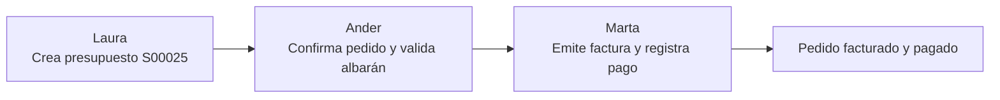

# Proceso de Ventas Completo — Kavárna Concept

En este documento explico paso a paso cómo he realizado un ciclo completo de venta en **Kavárna Concept** dentro de Odoo, desde que se prepara el presupuesto hasta que se cobra la factura. Todo el proceso está hecho cambiando de usuario en cada fase (Laura, Ander y Marta) para demostrar que los permisos y la separación de funciones funcionan de verdad.

---

## 1. Creación del presupuesto (Sesión de Laura)

Empecé iniciando sesión con la cuenta de **Laura** (Comercial Junior) para preparar la oferta comercial al cliente particular **Martín Lector**.

* **Número de presupuesto:** `S00025`
* **Cliente:** Martín Lector
* **Condiciones de pago:** Pago en 15 días 
* **Archivo exportado:** `venta/presupuesto.pdf`

### Desglose de productos e importes

Añadí las tres líneas de productos almacenables con su 21% de IVA correspondiente:
Al producto de la Taza Kavárna le añadí un 10% de descuento para ver como se ajustaba en el presupuesto.

| Referencia | Producto | Unidades | Precio Unitario | IVA | Subtotal |
| :--- | :--- | :---: | :---: | :---: | :---: |
| `KAV-TAZ-01` | Taza Kavárna | 1 | 13,05 € | 21% | 13,05 € |
| `KAV-TER-01` | Termo Nómada | 1 | 22,00 € | 21% | 22,00 € |
| `KAV-FUN-01` | Funda Hojas | 1 | 18,00 € | 21% | 18,00 € |
| | | | **Base Imponible** | | **53,05 €** |
| | | | **IVA (21%)** | | **11,14 €** |
| | | | **TOTAL** | | **64,19 €** |

Una vez revisado que todo cuadraba, guardé el presupuesto y cerré sesión. Como Laura tiene permisos limitados de comercial junior, aquí acaba su parte.

---

## 2. Confirmación del pedido y salida de almacén (Sesión de Ander)

A continuación, entré con la cuenta de **Ander** (Responsable de Ventas e Inventario) para aprobar la venta y gestionar la entrega física.

1. **Confirmar el pedido:** Abrí el presupuesto `S00025` que había dejado preparado Laura y pulsé en **Confirmar**. El documento pasó a estado **Pedido de venta** manteniendo la misma referencia (`S00025`) y bloqueando las líneas para que no se modifiquen por error.
2. **Validar la entrega (Albarán):** Al confirmarse, Odoo creó automáticamente una orden de entrega vinculada en el botón superior **Entrega** (`WH/OUT/00001`). Entré en el albarán, comprobé que las cantidades coincidían con lo pedido y pulsé en **Validar**.
3. **Comprobación de stock:** El albarán pasó a estado **Hecho** y verifiqué en el módulo de **Inventario** que se había descontado exactamente 1 unidad del stock disponible de la taza, el termo y la funda.

| Producto | Cantidad Pedida | Cantidad Entregada | Estado en Almacén |
| :--- | :---: | :---: | :--- |
| Taza Kavárna | 1 | 1 | Stock descontado |
| Termo Nómada | 1 | 1 | Stock descontado |
| Funda Hojas | 1 | 1 | Stock descontado |

---

## 3. Facturación y registro del cobro (Sesión de Marta)

Por último, inicié sesión con **Marta** (Administración y Facturación) para cerrar la parte económica de la venta.

1. **Generar la factura:** Accedí al pedido `S00025` (ya entregado) y pulsé en **Crear factura** (factura regular).
2. **Validar la factura:** Revisé que en el borrador aparecieran los datos fiscales de **Kavárna Concept**, el origen `S00025` y el importe total de **64,19 €**, y pulsé en **Confirmar**. Odoo le asignó la numeración oficial (`INV/2026/00001`).
3. **Registrar el pago:** Pulsé en **Registrar pago**, seleccioné el diario de **Banco**, confirmé el importe exacto de **64,19 €** y validé el cobro.
4. **Archivo exportado:** `venta/factura.pdf`

Al terminar, la factura quedó marcada con la etiqueta **Pagado** (importe pendiente: `0,00 €`) y, al volver al pedido `S00025`, su estado de facturación se actualizó automáticamente a **Totalmente facturado**.

---

## 4. Trazabilidad y verificación final

Para comprobar que todo el circuito estaba bien enlazado de principio a fin, verifiqué los botones inteligentes (*smart buttons*) dentro del pedido `S00025` y comparé los documentos generados:

| Etapa | Responsable | Documento / Referencia | Estado Final | Comprobación realizada |
| :--- | :--- | :--- | :--- | :--- |
| **Presupuesto** | Laura | `S00025` (`venta/presupuesto.pdf`) | Confirmado | Total de 64,19 € con IVA incluido. |
| **Entrega** | Ander | `WH/OUT/00001` | Hecho | Origen `S00025` y stock descontado en inventario. |
| **Factura** | Marta | `INV/2026/00001` (`venta/factura.pdf`) | Pagado | Mismo importe (64,19 €) y origen `S00025`. |
| **Cobro** | Marta | Pago en diario Banco | Conciliado | Importe pendiente a 0,00 € y pedido "Totalmente facturado". |

Con esto queda comprobado que ningún usuario ha tenido que hacer el proceso entero por su cuenta y que Odoo mantiene toda la trazabilidad conectada entre Ventas, Inventario y Facturación. Lo podemos además comprobar en el video.